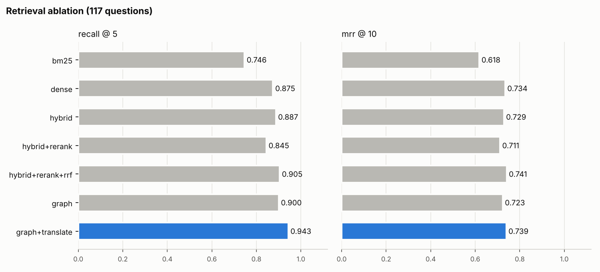
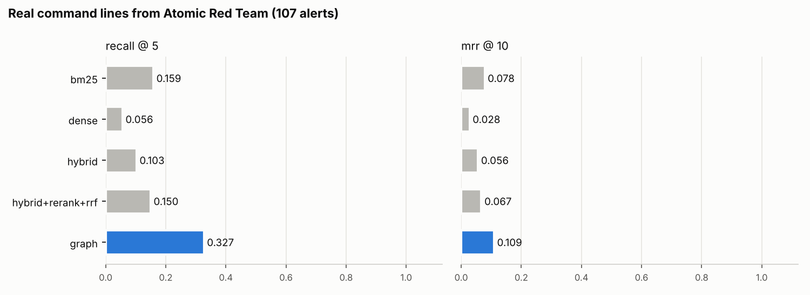
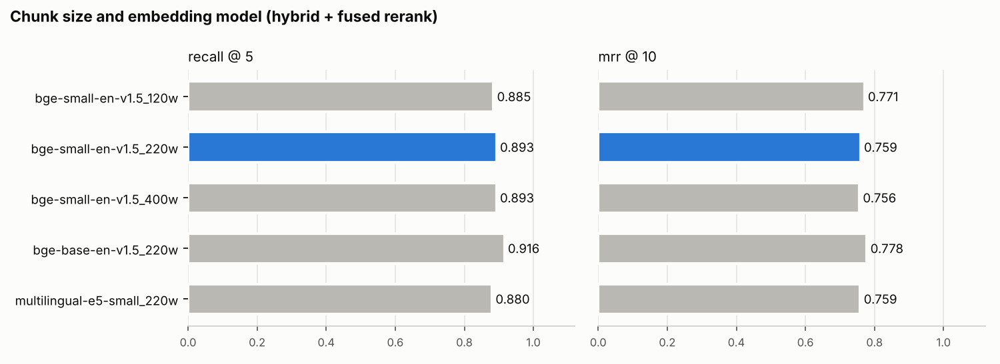

# ThreatLens 🔎

**Agentic RAG copilot for SOC & CTI analysts** — ask about an alert, a log line or a CVE and get a cited answer grounded in MITRE ATT&CK, CISA KEV, NVD, CERT-FR and SigmaHQ.

> Status: 🚧 work in progress — see [docs/ROADMAP.md](docs/ROADMAP.md)

## Highlights
Built and measured:
- **Hybrid retrieval**: BM25 + dense embeddings fused with RRF, cross-encoder reranking
- **A small knowledge graph from the sources' own links**: Sigma rule → ATT&CK technique → mitigation. A pasted command line is matched to detection rules, and the rules' tags lead to the technique (Recall@5 on 107 real command lines: 0.15 → 0.33)
- **Agent mode**: retrieval always runs first, then the model chooses tools (exact id lookup, KEV status, linked rules and mitigations, NVD, another search); every call is shown in the UI
- **Cited answers**: every claim points to its source (`[attack:T1059.001]`, `[kev:CVE-2024-3400]`); citations of documents the model was never given are flagged
- **French questions** are searched in both languages (Recall@5 0 → 5 of 5)
- **Measured, with error bars**: two retrieval benchmarks (117 questions, 107 real alerts), ablations, bootstrap confidence intervals, pinned data versions ([results](#results))
- **Runs anywhere**: FastAPI, Streamlit, Docker Compose, CI (ruff + pytest)

Planned ([roadmap](docs/ROADMAP.md)), not claimed yet:
- **Cost-aware LLM routing** (M3): a rule-based router exists; the learned router and the quality-vs-cost numbers do not
- **Prompt-injection defences** (M4): a heuristic guard and a delimited prompt exist; the attack/defence benchmark does not
- **Cloud deployment and monitoring** (M5)

## Architecture
```
            ┌─ exact id lookup (CVE / technique / advisory named in the question)
query ─► guard ─► hybrid retrieval (BM25 + dense, RRF; French also searched in English) ─► rerank
            └─ link expansion (alerts: techniques tagged by the matching Sigma rules)
      ─► sanitise ─► router ─► LLM ─► cited answer ─► citation check

agent mode: the same retrieval runs first, then the LLM may call tools
            (lookup · kev_status · related · nvd · search) before it answers
```
Details: [docs/SPEC.md](docs/SPEC.md)

## Quickstart
```bash
git clone https://github.com/waliddoesthis/threatlens && cd threatlens
python -m venv .venv && source .venv/bin/activate
make install
cp .env.example .env          # set your model names / API key; VECTOR_STORE=qdrant|chroma
ollama pull llama3.1:8b       # local small model (https://ollama.com); use the ollama_chat/ prefix
make ingest                   # download ATT&CK, KEV, Sigma, CERT-FR at pinned versions
make index                    # build indexes
make ui                       # http://localhost:8501
```

## Results
Every number below comes from a pinned corpus (ATT&CK v20.1, Sigma r2026-07-01, a fixed KEV snapshot, pinned CERT-FR advisories: [docs/DATA_SOURCES.md](docs/DATA_SOURCES.md)), 5,711 documents / 6,094 chunks. Raw numbers in [eval/results/](eval/results/), reasoning in [docs/DECISIONS.md](docs/DECISIONS.md).

### Retrieval, 117 questions
[eval/questions.jsonl](eval/questions.jsonl): ATT&CK technique paraphrases, mitigations, CVE nicknames, "which Sigma rule detects X", alerts, CERT-FR advisories and French questions.



| Retrieval | Recall@5 | 95% CI | MRR@10 | Δ Recall@5 vs hybrid (95% CI) |
|---|---|---|---|---|
| BM25 | 0.746 | 0.665–0.821 | 0.618 | −0.141 (−0.218 to −0.073) |
| Dense (bge-small-en-v1.5) | 0.875 | 0.813–0.929 | 0.734 | −0.013 (−0.051 to +0.026) |
| Hybrid (RRF) | 0.887 | 0.825–0.943 | 0.729 | – |
| Hybrid + cross-encoder rerank | 0.845 | 0.778–0.906 | 0.711 | −0.043 (−0.103 to +0.009) |
| Hybrid + rerank, RRF-fused | 0.905 | 0.848–0.956 | **0.741** | +0.017 (−0.017 to +0.051) |
| + link expansion and id lookup | 0.900 | 0.843–0.952 | 0.723 | +0.013 (−0.017 to +0.047) |
| + French query translation (default) | **0.943** | 0.900–0.983 | 0.739 | **+0.056 (+0.013 to +0.107)** |

Takeaways:
- **Most differences here are inside the noise.** With 117 questions, hybrid vs dense and the reranker's +0.017 have intervals that contain zero. Only "BM25 alone is worse" and "the full path beats plain hybrid" are supported. Earlier versions of this README called the reranker a win; the intervals say "not shown".
- **A reranker is not a free win.** On its own the cross-encoder ranks narrow Sigma rules above the ATT&CK technique a question is about, and scores below no reranker at all.
- **French went from 0 to 5 of 5** by translating the question with the small model and searching both wordings. A multilingual encoder alone had reached 0.2–0.4.
- **Per-type scores show what an average hides** ([by type](eval/results/retrieval.md)).

### Retrieval, 107 real alerts
The 5 alert questions above were written by hand and score 0.70. [eval/questions_alerts.jsonl](eval/questions_alerts.jsonl) is built from **Atomic Red Team**: real command lines, each labelled with the technique it exercises, never indexed ([how](eval/build_alert_questions.py)).



| Retrieval | Recall@5 | 95% CI |
|---|---|---|
| BM25 | 0.159 | 0.093–0.234 |
| Dense | 0.056 | 0.019–0.103 |
| Hybrid (RRF) | 0.103 | 0.047–0.168 |
| Hybrid + rerank, RRF-fused | 0.150 | 0.084–0.215 |
| + link expansion (default) | **0.327** | 0.243–0.411 |

- **The hand-written alerts were flattering.** On real command lines the retriever finds the right technique 15% of the time: `vssadmin.exe delete shadows /all /quiet` shares almost no words with a technique description.
- **Following links beats matching text.** Command lines do match Sigma rules, and each rule is tagged with its technique. Giving the last 3 places of the context to the techniques those rules point to doubles Recall@5 (paired Δ vs fused rerank +0.178, 95% CI +0.093 to +0.262; on the half of the questions not used to choose the setting: 0.132 → 0.302).
- **One alert in three is still weak**, and the gold label is strict (one sub-technique, no credit for its parent). This is the main retrieval gap left.
- A first design that re-ranked every question with the graph raised alerts but cut MRR on the 117 questions from 0.74 to 0.47. It was dropped ([decision](docs/DECISIONS.md)).

### Agent mode
`pipeline.answer(question, mode="agent")`, or the toggle in the UI. Retrieval and a KEV check on every CVE in the question run first; then the model may call `lookup`, `kev_status`, `related`, `nvd` or `search` (at most 4 turns) before it writes the answer. No framework: [agent.py](src/threatlens/agent.py) is a 160-line loop over tool calling.

Measured on the full answer benchmark (117 questions, `llama3.1:8b`, judge `qwen2.5:7b`, 8 GB RTX 2070, same pinned corpus as the pipeline run below; [results](eval/results/answers-llama3.1-8b-agent.md)):

| | Pipeline | Agent | Paired difference (95% CI) |
|---|---|---|---|
| Faithfulness (judge) | 0.885 | 0.910 | +0.026 (−0.012 to +0.062) |
| Relevancy (1–5) | 4.64 | 4.69 | +0.05 (−0.07 to +0.17) |
| Gold doc cited | 0.779 | 0.726 | −0.053 (−0.133 to +0.035) |
| Statements with a citation | 0.419 | 0.427 | +0.008 (−0.053 to +0.067) |
| Latency per answer | 40.7 s | 55.0 s | **+14.3 s (+12.0 to +16.2)** |

- **With an 8B model, agent mode is not shown to answer better, and it is 35% slower.** Every quality interval contains 0; the latency one does not. The pipeline stays the default.
- **The first agent stopped citing.** When one turn could either call a tool or answer, 81 of 117 answers carried no citation at all (18 for the pipeline) and the gold document was cited in 0.239 of them, while the judge still rated them as faithful (0.879). The agent now gathers with tools and the pipeline's own prompt writes the answer from at most 8 sources; uncited answers fell to 24 ([decision](docs/DECISIONS.md), [first run](eval/results/answers-llama3.1-8b-agent-oneturn.md)).
- **What it does with its freedom:** 1.1 tool calls per question, `related` 95 times, `search` 33, `lookup` 4, `kev_status` 2, `nvd` never. It mostly fetches a technique's Sigma rules and mitigations, yet the gold Sigma rule is cited on only 0.30 of detection questions (0.40 for the pipeline): the rules reach the context and the model still cites the technique instead.
- Without the forced first retrieval, a 4-question trial had the model look up `T1505` for Kerberoasting (it is T1558.003) and cite a Sigma rule id that does not exist. That is why retrieval is not the model's choice.
- Next test of the idea is a larger model in M3: the loop and the benchmark are ready, the 8B planner is the limit.

### Chunk size and embedding model


- **Chunk size (120 / 220 / 400 words) changes the scores by at most 0.014**, because most ATT&CK, KEV and Sigma records fit in one chunk at any of these sizes.
- **bge-base-en-v1.5 gains +0.015 Recall@5** (0.925) for 4× the build time and twice the vector size, so bge-small stays the default for CPU hosting. A bigger or multilingual encoder lifts French from 0 to only 0.2–0.4, so cross-lingual queries need query translation, not just a new model ([full table](eval/results/ablation.md)).

### Answer quality
Every answer is scored by an LLM judge (faithfulness = supported claims / claims, relevancy 1–5) **and** by deterministic checks: does it cite only ids it was given, does it cite the gold document, how many statements carry a citation, and does it state CVE / ATT&CK ids that appear in no source ([eval/run_answer_eval.py](eval/run_answer_eval.py)).

Full run on 117 questions, pinned corpus, generator `llama3.1:8b` through `ollama_chat/`, judge `qwen2.5:7b`, both on an 8 GB RTX 2070 via Ollama, at about 41 s per answer ([results](eval/results/answers-llama3.1-8b.md)). The 3B row is an older CPU sample from M2, kept for the comparison it makes:

| Generator | n | Faithfulness (judge) | Relevancy | Citation validity | Gold doc cited | Statements with a citation | Unsupported ids / answer |
|---|---|---|---|---|---|---|---|
| **llama3.1:8b** (GPU) | 117 | **0.885** | **4.64** | **0.980** | **0.779** | **0.419** | **0.28** |
| llama3.2:3b (CPU sample, M2) | 10 | 0.929 | 4.50 | 1.000 (2 answers) | 0.200 | 0.068 | 1.20 |

- **The judge alone would have picked the wrong model.** It rated the 3B model *more* faithful (0.93 vs 0.89) while the 3B model cited the gold document 4× less often and stated 4× more ATT&CK / CVE ids that appear in no source. That is why the deterministic citation checks sit next to the judge.
- **llama3.1:8b grounds technique questions well** (faithfulness 0.92, gold cited 0.96) **but not detections** (gold Sigma rule cited 0.40). It cites the ATT&CK technique and skips the rule, which is the gap the M4 prompt work targets.
- **French went from the weak spot to par**: in M2 retrieval found nothing and faithfulness was 0.47, relevancy 2.8. With query translation the 5 French questions score 0.95 and 4.8 (5 questions, so read it as "fixed", not as a ranking).
- **CERT-FR is now the weak spot**: on its 5 questions the gold advisory is cited in 0.40 of answers and 1.8 ids per answer appear in no source.
- M2 measured 0.875 faithfulness and 0.765 gold cited on 112 questions, before the corpus was pinned and through a route that flattened the system prompt. The re-run moved neither number by more than 0.015.
- These per-question rows ([jsonl](eval/results/answers-llama3.1-8b.jsonl)) are the training labels for the M3 router.

## Data
Public sources only — see [docs/DATA_SOURCES.md](docs/DATA_SOURCES.md). ATT&CK® is a registered trademark of The MITRE Corporation.

## Author
Walid Ichchou — [walidichchou.dev](https://walidichchou.dev)
